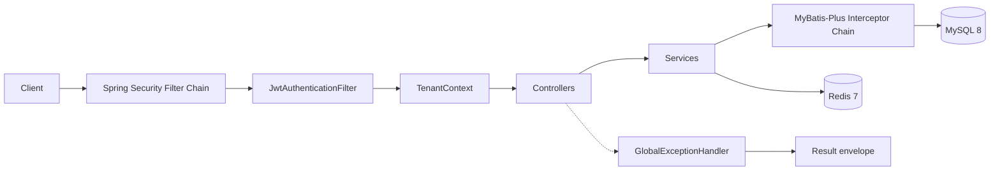

# saas-wq

A production-oriented multi-tenant SaaS backend built with Spring Boot 3, MyBatis-Plus and Spring Security (JWT).

The project demonstrates the engineering patterns expected from a commercial SaaS platform: a Maven multi-module layout, a unified response envelope with real HTTP status codes, row level tenant isolation powered by a ThreadLocal tenant context, stateless JWT authentication with Redis based token revocation, and OpenAPI 3 documentation.

Maintained by **wangqi**.

## Architecture



Every request passes through the following stages:

1. `JwtAuthenticationFilter` validates the token, rebuilds the security context and binds the tenant to the current thread.
2. `TenantContextInterceptor` rejects authenticated requests that lost the tenant binding and always releases it afterwards.
3. `TenantLineInnerInterceptor` rewrites every SQL statement targeting a tenant scoped table with `tenant_id = ?`.
4. Failures are translated by `GlobalExceptionHandler` into the unified `Result` body while the HTTP status stays meaningful (400 / 401 / 403 / 404 / 409 / 500).

## Modules

| Module | Responsibility |
| --- | --- |
| `saas-wq-common` | Unified `Result` envelope, `ResultCode` catalogue, paging payload, `BusinessException`, `GlobalExceptionHandler` |
| `saas-wq-framework` | JWT security chain, `TenantContext`, tenant interceptor, MyBatis-Plus configuration, Redis token revocation, OpenAPI configuration |
| `saas-wq-server` | Executable backend: `Tenant`, `SysUser` and `Customer` entities with CRUD, Flyway migrations and demo data |
| `saas-wq-web` | Reserved for the Vue 3 + Vite administration console (iteration 2) |

## Tech stack

| Component | Version |
| --- | --- |
| Java | 17 |
| Spring Boot | 3.3.5 |
| Spring Security | 6.3.x |
| MyBatis-Plus | 3.5.9 |
| MySQL | 8.0 (5.7 compatible) |
| Redis | 7 |
| JJWT | 0.12.6 |
| Springdoc OpenAPI | 2.6.0 |
| Flyway | 10.x |

## Key features

- **Unified response with real HTTP status codes.** Successful calls return `200`; business failures return the status declared by `ResultCode` (for example `404` for a missing tenant, `409` for a duplicated username) while the body keeps a business code and a timestamp.
- **Row level multi-tenant isolation.** Tenant scoped tables are filtered on read, updated, deleted and stamped on insert automatically. The tenant registry itself is global and excluded from filtering.
- **Stateless JWT authentication.** Tenant code, user id, tenant id and role are embedded as claims. The same username can exist in different tenants without collisions.
- **Token revocation with Redis.** Logout writes the token id into a deny list bounded by the remaining token lifetime.
- **Strict request validation.** Jakarta Validation on every payload plus pagination bounds, translated into readable 400 responses.
- **Logic deletion and audit columns.** Handled centrally through MyBatis-Plus annotations and a meta object handler.
- **Schema as code.** Flyway migrations create the schema and load demonstration data on first start.
- **API documentation.** Swagger UI is available without authentication; all protected endpoints can be called directly with a bearer token.

## Quick start

### Prerequisites

- JDK 17+
- Maven 3.9+
- Docker with Compose (recommended for MySQL and Redis), or local MySQL and Redis instances

### 1. Start infrastructure

```bash
cp .env.example .env      # optional, adjust credentials if needed
docker compose up -d
```

MySQL listens on `localhost:3306` and Redis on `localhost:6379` by default.
Host ports can be changed with `MYSQL_HOST_PORT` and `REDIS_HOST_PORT`.

### 2. Build and run

```bash
mvn clean package
java -jar saas-wq-server/target/saas-wq-server.jar
```

Flyway creates the schema and inserts the demo data automatically.

| URL | Description |
| --- | --- |
| http://localhost:8080/swagger-ui.html | Swagger UI |
| http://localhost:8080/v3/api-docs | OpenAPI document |

### 3. Demo accounts

Every demo account uses the password `Admin@123`.

| Tenant code | Username | Role | Scope |
| --- | --- | --- | --- |
| `platform` | `superadmin` | `SUPER_ADMIN` | Manage tenants |
| `acme` | `acme.admin` | `TENANT_ADMIN` | Acme users and customers |
| `acme` | `acme.member` | `MEMBER` | Read Acme customers |
| `globex` | `globex.admin` | `TENANT_ADMIN` | Globex users and customers |

Login example:

```bash
curl -s -X POST http://localhost:8080/api/auth/login \
  -H "Content-Type: application/json" \
  -d '{"tenantCode":"acme","username":"acme.admin","password":"Admin@123"}'
```

## API overview

| Method | Path | Access | Purpose |
| --- | --- | --- | --- |
| `POST` | `/api/auth/login` | public | Authenticate inside a tenant |
| `POST` | `/api/auth/logout` | authenticated | Revoke the current token |
| `GET` | `/api/auth/me` | authenticated | Current profile |
| `GET` | `/api/tenants` | `SUPER_ADMIN` | List tenants with pagination |
| `GET` | `/api/tenants/{id}` | `SUPER_ADMIN` | Tenant details |
| `POST` | `/api/tenants` | `SUPER_ADMIN` | Register a tenant |
| `PUT` | `/api/tenants/{id}` | `SUPER_ADMIN` | Update a tenant |
| `DELETE` | `/api/tenants/{id}` | `SUPER_ADMIN` | Delete a tenant without users |
| `GET` | `/api/users` | admin roles | List users of the current tenant |
| `POST` | `/api/users` | admin roles | Create a user in the current tenant |
| `PUT` | `/api/users/{id}` | admin roles | Update a user |
| `DELETE` | `/api/users/{id}` | admin roles | Delete a user |
| `GET` | `/api/customers` | any authenticated member | List customers of the current tenant |
| `GET` | `/api/customers/{id}` | any authenticated member | Customer details |
| `POST` | `/api/customers` | admin roles | Create a customer |
| `PUT` | `/api/customers/{id}` | admin roles | Update a customer |
| `DELETE` | `/api/customers/{id}` | admin roles | Delete a customer |

All list endpoints accept `page`, `size` (1-100) and an optional `keyword`.

## Tenant isolation in practice

A call from an `acme` token performs this query behind the scenes:

```sql
SELECT id, tenant_id, name, company, email, phone, status, remark, created_at, updated_at
FROM biz_customer
WHERE deleted = 0
  AND tenant_id = 2
ORDER BY created_at DESC
LIMIT 10;
```

Requesting a customer that belongs to another tenant returns `404`, and the response body still follows the unified envelope:

```json
{
  "code": 404,
  "message": "Resource not found",
  "data": null,
  "timestamp": 1794975378644
}
```

## Configuration

| Variable | Default | Description |
| --- | --- | --- |
| `SERVER_PORT` | `8080` | HTTP port |
| `DB_HOST` / `DB_PORT` | `localhost` / `3306` | MySQL endpoint |
| `DB_NAME` | `saas_wq` | Database name |
| `DB_USER` / `DB_PASSWORD` | `saas` / `saas123` | Database credentials |
| `REDIS_HOST` / `REDIS_PORT` | `localhost` / `6379` | Redis endpoint |
| `JWT_SECRET` | development value | HMAC secret, override in production |
| `JWT_EXPIRATION` | `PT12H` | Token lifetime (ISO-8601 duration) |

## Project status

Iteration 1 delivers the platform foundation. Planned next steps:

- Vue 3 + Vite administration console in `saas-wq-web`
- Unit and integration test suite for services and security
- Role and permission management, audit logging
- Docker image for the application itself
