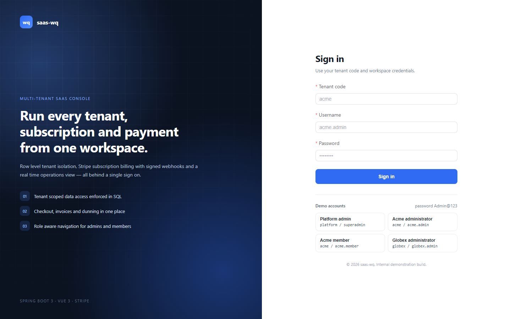
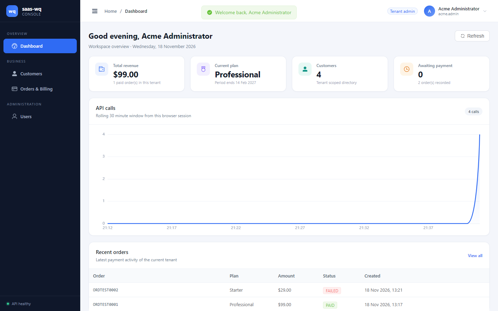
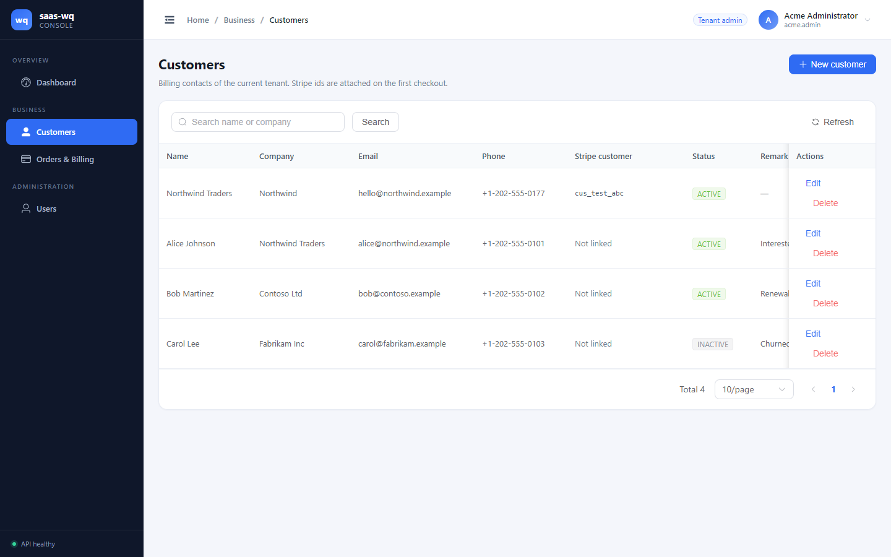
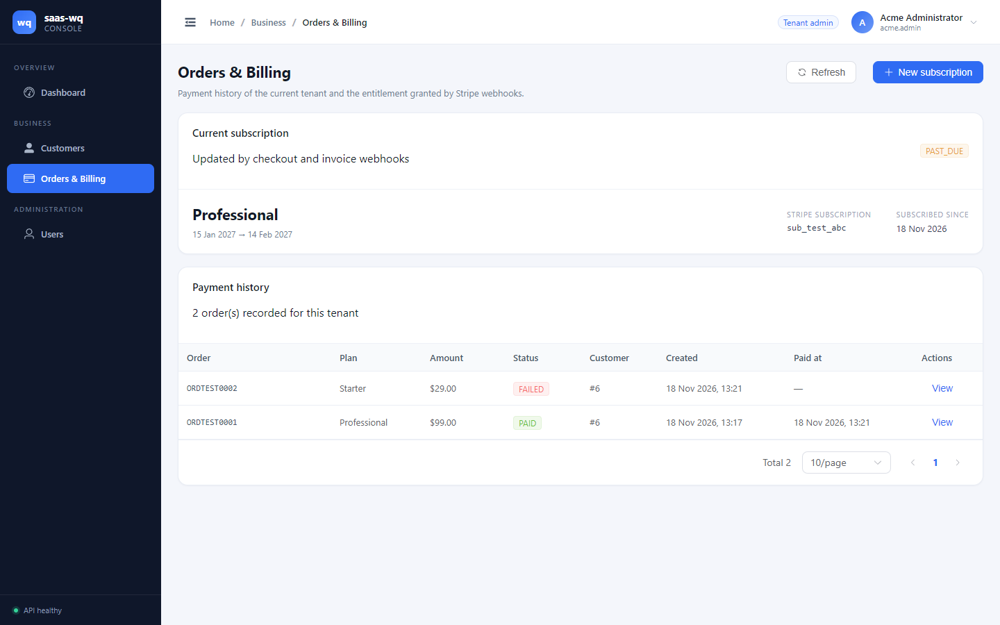
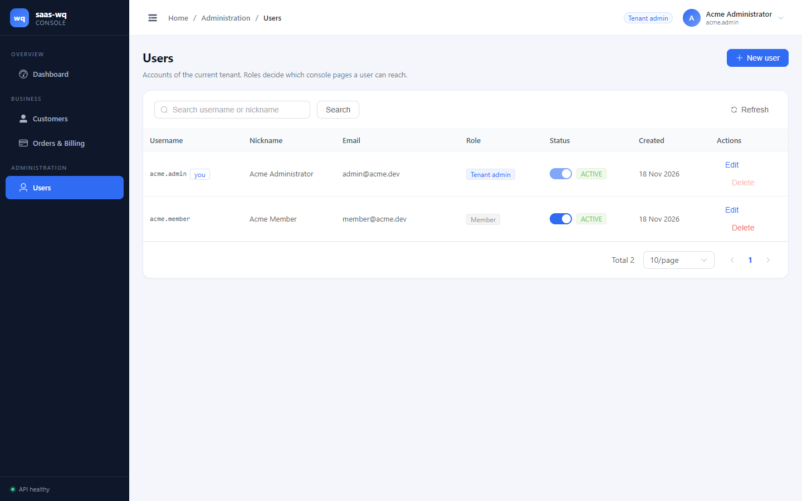
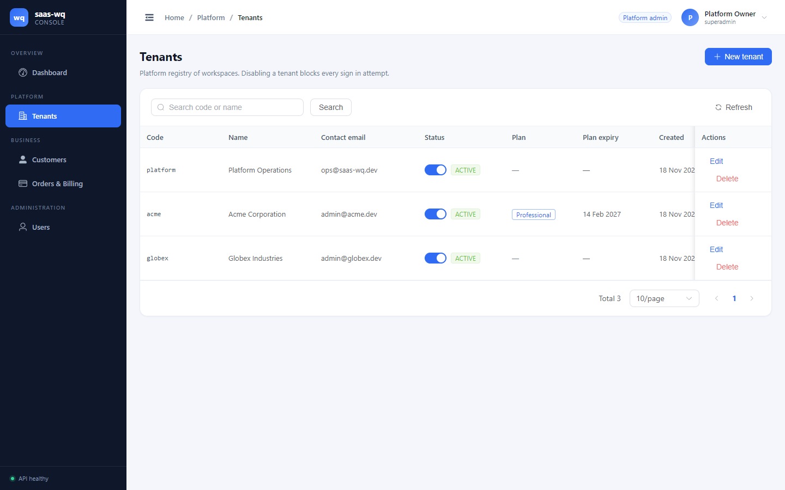
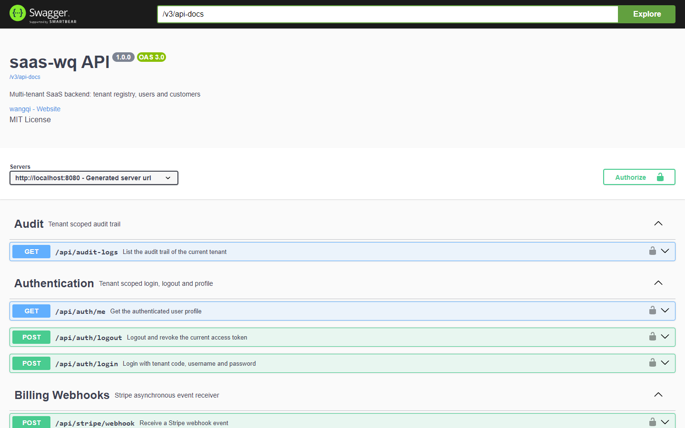

# saas-wq

**A production-grade, multi-tenant SaaS platform reference implementation.**


`saas-wq` is a complete multi-tenant SaaS starter: a Spring Boot 3 backend, a Vue 3 administration console, MySQL and Redis infrastructure, Stripe subscription billing with signed webhooks, role based access control with a tenant scoped audit trail, and first class observability. Everything ships in containers and starts with a single command.

It is written the way a commercial product is written: a Maven multi-module backend, a unified response envelope mapped to real HTTP status codes, row level tenant isolation enforced in SQL, stateless JWT authentication with Redis backed revocation, atomic tenant rate limiting, structured logs, Prometheus metrics, distributed tracing and an automated test suite that runs against real MySQL and Redis instances.

Maintained by **Qi Wang**.

---

## Table of contents

- [Why this project](#why-this-project)
- [Screenshots](#screenshots)
- [Architecture](#architecture)
  - [Request lifecycle](#request-lifecycle)
  - [Deployment topology](#deployment-topology)
  - [Modules](#modules)
  - [Repository layout](#repository-layout)
- [Tech stack](#tech-stack)
- [Quick start](#quick-start)
- [Demo accounts](#demo-accounts)
- [Configuration](#configuration)
  - [Compose variables](#compose-variables-env)
  - [Backend runtime variables](#backend-runtime-variables)
  - [Frontend variables](#frontend-variables)
- [API guide](#api-guide)
  - [Authenticate](#authenticate)
  - [Customer CRUD](#customer-crud)
  - [Access control in action](#access-control-in-action)
  - [Rate limiting](#rate-limiting-response)
  - [Audit trail](#audit-trail)
  - [Role administration](#role-administration)
  - [Metrics](#metrics)
  - [Stripe webhooks](#stripe-webhooks)
- [Postman collection](#postman-collection)
- [Security model](#security-model)
- [Audit logging](#audit-logging)
- [Observability](#observability)
- [Testing](#testing)
- [Subscription billing](#subscription-billing)
- [Container images](#container-images)
- [Roadmap](#roadmap)

---

## Why this project

Most SaaS examples stop at CRUD. This one models the concerns that decide whether a multi-tenant product survives production:

| Concern | How it is solved here |
| --- | --- |
| Tenant isolation | Every tenant scoped table is rewritten with `tenant_id = ?` by MyBatis-Plus, on reads, updates, deletes and inserts |
| Authentication | Stateless JWT with tenant aware claims, BCrypt passwords and a Redis deny list for logout |
| Authorization | Roles are bound to permissions (`resource:action`); the security context carries the codes and controllers use `@PreAuthorize` |
| Accountability | Every write operation is captured by an AOP audit aspect with masked payloads, duration, actor and client IP |
| Fair usage | A Redis Lua script enforces a per tenant fixed window quota; throttled requests return `429` with `Retry-After` and `X-RateLimit-*` |
| Billing | Stripe Checkout sessions, signed and idempotent webhooks, order and subscription reconciliation, tenant entitlement |
| Operations | Structured JSON logs with MDC context, Prometheus metrics, Zipkin tracing and health probes |
| Confidence | 37 automated tests: pure unit tests for security, rate limiting and webhook handling, plus Testcontainers integration tests on real MySQL 8 and Redis 7 |

---

## Screenshots

| Sign in | Dashboard |
| --- | --- |
|  |  |

| Customers | Orders and billing |
| --- | --- |
|  |  |

| Users and roles | Tenant registry |
| --- | --- |
|  |  |

| OpenAPI console (`/swagger-ui.html`) |
| --- |
|  |

---

## Architecture

```mermaid
flowchart TB
    subgraph Clients
        B[Vue 3 console]
        A[API client / cURL / Postman]
    end

    B -->|/api| N[Nginx reverse proxy]
    A --> N

    N --> F[Spring Security filter chain]
    F --> J[JwtAuthenticationFilter<br/>claims + permission lookup]
    J --> M[MdcContextFilter<br/>traceId / tenantId / userId]
    M --> T[TenantContextInterceptor]
    T --> R[TenantRateLimitInterceptor<br/>Redis Lua quota]
    R -->|allowed| C[Controllers<br/>@PreAuthorize + @Audit]
    R -.->|quota exhausted| X[429 Result envelope]

    C --> S[Services]
    S --> P[MyBatis-Plus interceptor chain<br/>tenant line + logic delete]
    P --> DB[(MySQL 8<br/>Flyway migrations)]
    S --> RD[(Redis 7<br/>token deny list, rate limit, RBAC cache, webhook idempotency)]
    S --> ST[Stripe API]

    C -.-> AU[AuditLogAspect]
    AU --> DB

    M -.-> MT[Prometheus / Actuator]
    M -.-> TR[Brave + Zipkin]
```

### Request lifecycle

1. **Nginx** serves the static console and proxies `/api` to the backend (in the Compose stack).
2. **`JwtAuthenticationFilter`** validates the bearer token, rebuilds the `SecurityContext`, injects `ROLE_<CODE>` plus the permission codes of the role, and binds the tenant and user to the MDC.
3. **`MdcContextFilter`** guarantees the logging context is cleared even when the request fails.
4. **`TenantContextInterceptor`** rejects authenticated requests that lost their tenant binding and always releases the thread local afterwards.
5. **`RateLimitInterceptor`** consumes one unit of the tenant quota through a single Lua script and short circuits with `429` once the per minute budget is exhausted.
6. **`@PreAuthorize`** checks the required permission code, then the controller executes the use case; writes annotated with `@Audit` are recorded asynchronously in the same request.
7. **`TenantLineInnerInterceptor`** rewrites every statement touching a tenant scoped table with `tenant_id = ?`.
8. **`GlobalExceptionHandler`** translates failures into the unified `Result` body while keeping the HTTP status meaningful (`400 / 401 / 403 / 404 / 409 / 429 / 500`).

### Deployment topology

```text
                          Docker network: saas-wq_default
  Browser / cURL                ┌──────────────────────────────────────────────┐
  ───────────────►  :8080 ─────►│ web (nginx:1.27-alpine)                      │
                                │   • serves the Vue build                     │
                                │   • SPA fallback to index.html               │
                                │   • proxy_pass /api → saas-wq-server:8080    │
                                └──────────────────┬───────────────────────────┘
                                                   │
                        :8081 (host) ─────────────►│
                                ┌──────────────────▼───────────────────────────┐
                                │ saas-wq-server (temurin 17 JRE, non-root)    │
                                │   • Spring Boot 3.3.5 API                    │
                                │   • Flyway migrations V1..V4 on startup      │
                                │   • actuator health / prometheus / metrics   │
                                └───────┬───────────────────────────┬──────────┘
                                        │ JDBC                      │ Lettuce
                                ┌───────▼───────┐           ┌───────▼────────┐
                                │ mysql:8.0     │           │ redis:7-alpine │
                                │ :3306         │           │ :6379          │
                                └───────────────┘           └────────────────┘
```

Only the console (`8080`) and the API (`8081`) are published by default. MySQL and Redis stay on the internal Docker network.

### Modules

| Module | Responsibility |
| --- | --- |
| `saas-wq-common` | Unified `Result` envelope, `ResultCode` catalogue, paging payload, `BusinessException`, `GlobalExceptionHandler` |
| `saas-wq-framework` | JWT security chain, `TenantContext`, tenant interceptor, Redis token revocation, Redis + Lua tenant rate limiter, MDC filter, MyBatis-Plus configuration, OpenAPI configuration |
| `saas-wq-server` | Executable application: tenants, users, RBAC, audit trail, customers, orders, subscriptions, Stripe Checkout and webhooks, Flyway migrations, metrics and tracing |
| `saas-wq-web` | Vue 3 + Vite administration console: login, layout shell, dashboard and CRUD screens |
| `postman` | Ready to run Postman collection and environment |
| `assets` | Screenshots referenced by this document |

### Repository layout

```text
saas-wq/
├── saas-wq-common/          shared envelope, error catalogue, paging
├── saas-wq-framework/       security, tenant context, rate limiting, logging, MyBatis-Plus
├── saas-wq-server/          REST API, services, Stripe integration, Flyway, tests
│   └── src/main/resources/
│       ├── db/migration/    V1 schema, V2 demo data, V3 billing, V4 RBAC + audit
│       ├── lua/             tenant_rate_limit.lua
│       ├── application.yml
│       └── logback-spring.xml
├── saas-wq-web/             Vue 3 console, Dockerfile, nginx.conf
├── postman/                 collection + environment
├── assets/screenshots/      console and API screenshots
├── Dockerfile               multi-stage backend image
├── docker-compose.yml       full stack orchestration
└── .env.example             every supported compose variable
```

---

## Tech stack

| Component | Version |
| --- | --- |
| Java | 17 |
| Spring Boot | 3.3.5 |
| Spring Security | 6.3.x |
| MyBatis-Plus | 3.5.9 |
| MySQL | 8.0 |
| Redis | 7 |
| JJWT | 0.12.6 |
| Stripe Java SDK | 28.4.0 |
| Springdoc OpenAPI | 2.6.0 |
| Flyway | 10.x |
| Micrometer / Prometheus | Spring Boot managed |
| Brave / Zipkin | Spring Boot managed |
| Logstash Logback Encoder | 7.4 |
| JUnit 5 / Mockito / Testcontainers | Spring Boot managed |
| Vue / Vite / Element Plus | 3.5 / 6 / 2.9 |
| Docker / Compose | any recent release |

---

## Quick start

### Prerequisites

- Docker with Compose v2 (or Docker Compose v1)
- 4 GB of free memory for MySQL, Redis, the JVM and Nginx

### One command startup

```bash
git clone https://github.com/your-org/saas-wq.git
cd saas-wq
cp .env.example .env
docker compose up --build
```

On Docker Compose v1 use `docker-compose up --build` instead.

The first run builds both images, waits for MySQL and Redis to report healthy, applies the Flyway migrations (`V1` to `V4`), then starts the console. Once every container is healthy:

| URL | Description |
| --- | --- |
| http://localhost:8080 | Vue 3 administration console |
| http://localhost:8081/swagger-ui.html | Swagger UI |
| http://localhost:8081/v3/api-docs | OpenAPI document |
| http://localhost:8081/actuator/health | Backend health probe |
| http://localhost:8081/actuator/prometheus | Prometheus scrape endpoint |

Stop the stack with `docker compose down`; add `-v` to also delete the MySQL and Redis volumes.

### Demo accounts

Every demo account uses the password `Admin@123`.

| Tenant code | Username | Role | Scope |
| --- | --- | --- | --- |
| `platform` | `superadmin` | `SUPER_ADMIN` | Manage tenants and role permissions |
| `acme` | `acme.admin` | `TENANT_ADMIN` | Acme users, customers, billing and audit |
| `acme` | `acme.member` | `MEMBER` | Read Acme customers, orders and subscription |
| `globex` | `globex.admin` | `TENANT_ADMIN` | Globex users, customers, billing and audit |

---

## Configuration

### Compose variables (`.env`)

These variables are read by `docker-compose.yml`. Copy `.env.example` to `.env` and override what you need.

| Variable | Default | Description |
| --- | --- | --- |
| `MYSQL_ROOT_PASSWORD` | `root123` | MySQL root password |
| `DB_NAME` | `saas_wq` | Database created on first start |
| `DB_USER` / `DB_PASSWORD` | `saas` / `saas123` | Application database credentials |
| `MYSQL_HOST_PORT` | `3306` | Host port published for MySQL |
| `REDIS_HOST_PORT` | `6379` | Host port published for Redis |
| `BACKEND_HOST_PORT` | `8081` | Host port published for the API |
| `WEB_HOST_PORT` | `8080` | Host port published for the console |
| `JWT_SECRET` | development value | HMAC signing secret, **change it in production** |
| `JWT_EXPIRATION` | `PT12H` | Access token lifetime (ISO-8601 duration) |
| `RATE_LIMIT_ENABLED` | `true` | Enable the per tenant quota |
| `RATE_LIMIT_REQUESTS_PER_MINUTE` | `60` | Requests allowed per tenant per minute |
| `STRIPE_SECRET_KEY` | empty | Stripe secret key; checkout returns `503` while empty |
| `STRIPE_WEBHOOK_SECRET` | empty | Webhook signing secret; deliveries are rejected while empty |
| `STRIPE_SUCCESS_URL` / `STRIPE_CANCEL_URL` | console URLs | Browser redirects after checkout |
| `STRIPE_CURRENCY` | `usd` | Currency used for inline plan prices |
| `TRACING_SAMPLING_PROBABILITY` | `1.0` | Fraction of requests exported as spans (0.0 - 1.0) |
| `ZIPKIN_ENDPOINT` | empty | Zipkin base URL; span export is disabled while empty |

### Backend runtime variables

The same application runs outside Docker. These variables are honoured by `java -jar` as well as by Compose.

| Variable | Default | Description |
| --- | --- | --- |
| `SERVER_PORT` | `8080` | API port |
| `SPRING_PROFILES_ACTIVE` | `dev` | `dev` or `test` print colourised logs; any other profile emits JSON |
| `DB_HOST` / `DB_PORT` | `localhost` / `3306` | MySQL endpoint |
| `DB_NAME` | `saas_wq` | Database name |
| `DB_USER` / `DB_PASSWORD` | `saas` / `saas123` | Database credentials |
| `REDIS_HOST` / `REDIS_PORT` | `localhost` / `6379` | Redis endpoint |
| `REDIS_PASSWORD` | empty | Redis password when authentication is enabled |
| `RATE_LIMIT_KEY_PREFIX` | `saas-wq:rate-limit:` | Redis namespace of the quota counters |
| `TRACING_SAMPLING_PROBABILITY` | `1.0` | Trace sampling probability |
| `ZIPKIN_ENDPOINT` | empty | Zipkin collector URL |

Plan prices live under `wq.stripe.plans` in `application.yml`. Set `stripe-price-id` on a plan to use a price created in the Stripe dashboard instead of an inline price.

### Frontend variables

| Variable | Default | Description |
| --- | --- | --- |
| `VITE_API_BASE_URL` | `/api` | Axios base path; keep the relative default in containers |
| `VITE_PROXY_TARGET` | `http://localhost:8080` | Backend address used by the Vite dev proxy |

---

## API guide

All examples below assume the backend is reachable at `http://localhost:8080` (a locally started jar). With the Compose stack, replace the port with `8081`.

### Authenticate

```bash
curl -s -X POST http://localhost:8080/api/auth/login \
  -H "Content-Type: application/json" \
  -d '{"tenantCode":"acme","username":"acme.admin","password":"Admin@123"}'
```

```json
{
  "code": 200,
  "message": "Success",
  "data": {
    "accessToken": "eyJhbGciOiJIUzI1NiJ9...",
    "tokenType": "Bearer",
    "expiresIn": 43200,
    "user": {
      "id": 2,
      "tenantId": 2,
      "username": "acme.admin",
      "nickname": "Acme Administrator",
      "role": "TENANT_ADMIN",
      "status": "ACTIVE"
    }
  },
  "timestamp": 1795008985898
}
```

Export the token once and reuse it:

```bash
TOKEN=$(curl -s -X POST http://localhost:8080/api/auth/login \
  -H "Content-Type: application/json" \
  -d '{"tenantCode":"acme","username":"acme.admin","password":"Admin@123"}' \
  | jq -r '.data.accessToken')
```

```bash
curl -s http://localhost:8080/api/auth/me -H "Authorization: Bearer $TOKEN"
```

### Customer CRUD

```bash
# List, paged
curl -s "http://localhost:8080/api/customers?page=1&size=10&keyword=northwind" \
  -H "Authorization: Bearer $TOKEN"

# Create
curl -s -X POST http://localhost:8080/api/customers \
  -H "Authorization: Bearer $TOKEN" \
  -H "Content-Type: application/json" \
  -d '{"name":"Grace Hopper","company":"Navy Systems","email":"grace@navy.example","phone":"+1-202-555-0199","status":"ACTIVE"}'
```

```json
{
  "code": 200,
  "message": "Success",
  "data": {
    "id": 7,
    "name": "Grace Hopper",
    "company": "Navy Systems",
    "email": "grace@navy.example",
    "phone": "+1-202-555-0199",
    "stripeCustomerId": null,
    "status": "ACTIVE",
    "remark": null,
    "createdAt": "2026-11-18T21:36:35"
  },
  "timestamp": 1795008995552
}
```

```bash
# Update
curl -s -X PUT http://localhost:8080/api/customers/7 \
  -H "Authorization: Bearer $TOKEN" \
  -H "Content-Type: application/json" \
  -d '{"name":"Grace Hopper","company":"Navy Systems","status":"INACTIVE"}'

# Delete (logical)
curl -s -X DELETE http://localhost:8080/api/customers/7 \
  -H "Authorization: Bearer $TOKEN"
```

Requesting a customer owned by another tenant returns `404`, never `403`, so the existence of foreign records is not leaked.

### Access control in action

`acme.member` is read only. Calling an endpoint that requires `user:read`:

```bash
MEMBER_TOKEN=$(curl -s -X POST http://localhost:8080/api/auth/login \
  -H "Content-Type: application/json" \
  -d '{"tenantCode":"acme","username":"acme.member","password":"Admin@123"}' \
  | jq -r '.data.accessToken')

curl -i -s http://localhost:8080/api/users -H "Authorization: Bearer $MEMBER_TOKEN"
```

```http
HTTP/1.1 403 Forbidden
Content-Type: application/json

{"code":403,"message":"You are not allowed to perform this operation","data":null,"timestamp":1795008986282}
```

### Rate limiting response

Exceeding `RATE_LIMIT_REQUESTS_PER_MINUTE` within one minute for a tenant produces:

```http
HTTP/1.1 429 Too Many Requests
Retry-After: 14
X-RateLimit-Limit: 60
X-RateLimit-Remaining: 0
X-RateLimit-Reset: 1795009020
Content-Type: application/json

{"code":2007,"message":"Quota of 60 requests per minute exceeded","data":null,"timestamp":1795008999550}
```

### Audit trail

```bash
curl -s "http://localhost:8080/api/audit-logs?action=CUSTOMER_CREATE&size=5" \
  -H "Authorization: Bearer $TOKEN"
```

```json
{
  "code": 200,
  "message": "Success",
  "data": {
    "records": [
      {
        "id": 12,
        "tenantId": 2,
        "userId": 2,
        "username": "acme.admin",
        "action": "CUSTOMER_CREATE",
        "resource": "CUSTOMER",
        "httpMethod": "POST",
        "uri": "/api/customers",
        "requestArgs": "{\"name\":\"Grace Hopper\",\"company\":\"Navy Systems\",\"email\":\"grace@navy.example\",\"status\":\"ACTIVE\"}",
        "success": true,
        "errorMessage": null,
        "durationMs": 18,
        "ipAddress": "127.0.0.1",
        "createdAt": "2026-11-18T21:40:12"
      }
    ],
    "total": 1,
    "page": 1,
    "size": 5,
    "pages": 1
  },
  "timestamp": 1795009210000
}
```

Supported filters: `action`, `username`, `success`, plus `page` / `size`.

### Role administration

```bash
SUPER_TOKEN=$(curl -s -X POST http://localhost:8080/api/auth/login \
  -H "Content-Type: application/json" \
  -d '{"tenantCode":"platform","username":"superadmin","password":"Admin@123"}' \
  | jq -r '.data.accessToken')

# Catalogue
curl -s http://localhost:8080/api/rbac/roles -H "Authorization: Bearer $SUPER_TOKEN"
curl -s http://localhost:8080/api/rbac/permissions -H "Authorization: Bearer $SUPER_TOKEN"

# Replace the permission set of a role; changes apply on the next request
curl -s -X PUT http://localhost:8080/api/rbac/roles/MEMBER/permissions \
  -H "Authorization: Bearer $SUPER_TOKEN" \
  -H "Content-Type: application/json" \
  -d '{"permissionCodes":["customer:read","order:read","subscription:read"]}'
```

`SUPER_ADMIN` cannot be downgraded: the call returns `409 Conflict`. Unknown permission codes return `400`.

### Metrics

```bash
curl -s http://localhost:8080/actuator/prometheus | grep '^saaswq_'
```

```text
saaswq_auth_login_total{application="saas-wq-server",outcome="success"} 5.0
saaswq_rate_limit_rejected_total{application="saas-wq-server",tenant="2"} 1.0
```

Actuator exposures are `health`, `info`, `metrics` and `prometheus`. Health details are only shown to authorised callers.

### Stripe webhooks

```bash
stripe listen --forward-to localhost:8080/api/stripe/webhook
```

The endpoint verifies `Stripe-Signature` with `STRIPE_WEBHOOK_SECRET`, claims the event id in Redis for seven days and applies status guarded updates. Replaying the same event returns `duplicate: true` without touching the database.

---

## Postman collection

Import both files from the `postman` directory:

| File | Purpose |
| --- | --- |
| `postman/saas-wq.postman_collection.json` | Auth, Customers, Users, Billing, RBAC, Audit and Operations requests |
| `postman/saas-wq.postman_environment.json` | `baseUrl`, `tenantCode`, `username`, `password` and `token` |

Select the environment, run **Auth → Login** once: the test script stores the access token in the collection variable and every other request inherits it. The environment ships with the `acme` demo tenant; switch `tenantCode` to `platform` to exercise the RBAC folder.

---

## Security model

### Roles and permissions

Roles are global definitions; users are bound to a role through `sys_user.role`. Permissions use the `resource:action` convention and are resolved once per request through `PermissionService`, which caches the role to permission mapping in Redis for 30 minutes and evicts it whenever the mapping changes.

| Permission | `SUPER_ADMIN` | `TENANT_ADMIN` | `MEMBER` |
| --- | :---: | :---: | :---: |
| `tenant:read` | ✅ | | |
| `tenant:write` | ✅ | | |
| `user:read` | ✅ | ✅ | |
| `user:write` | ✅ | ✅ | |
| `customer:read` | ✅ | ✅ | ✅ |
| `customer:write` | ✅ | ✅ | |
| `order:read` | ✅ | ✅ | ✅ |
| `order:write` | ✅ | ✅ | |
| `subscription:read` | ✅ | ✅ | ✅ |
| `audit:read` | ✅ | ✅ | |
| `rbac:read` | ✅ | ✅ | |
| `rbac:write` | ✅ | | |

### Authentication

- Passwords are hashed with BCrypt; credentials are scoped by tenant code so the same username can exist in several tenants.
- Tokens embed the tenant id, tenant code, user id, username and role, and expire after `JWT_EXPIRATION`.
- Logout writes the token id into a Redis deny list bounded by the remaining lifetime, so revocation survives restarts.
- Every protected controller declares the exact permission code it needs; there is no implicit "authenticated means allowed".

### Tenant isolation

A call from an `acme` token performs this query behind the scenes:

```sql
SELECT id, tenant_id, name, company, email, phone, status, remark, created_at, updated_at
FROM biz_customer
WHERE deleted = 0
  AND tenant_id = 2
ORDER BY created_at DESC
LIMIT 10;
```

The tenant registry (`sys_tenant`) and the RBAC catalogues are global and excluded from the tenant line interceptor.

---

## Audit logging

Annotate a write endpoint with `@Audit` and the aspect records the invocation without ever changing its outcome:

```java
@PreAuthorize("hasAuthority('customer:write')")
@Audit(action = "CUSTOMER_CREATE", resource = "CUSTOMER")
@PostMapping
public Result<CustomerVO> create(@Valid @RequestBody CustomerCreateRequest request) {
    return Result.success(customerService.create(request));
}
```

| Action | Resource | Trigger |
| --- | --- | --- |
| `AUTH_LOGIN` / `AUTH_LOGOUT` | `AUTH` | Sign in and sign out |
| `TENANT_CREATE` / `TENANT_UPDATE` / `TENANT_DELETE` | `TENANT` | Platform tenant registry |
| `USER_CREATE` / `USER_UPDATE` / `USER_DELETE` | `USER` | Tenant users |
| `CUSTOMER_CREATE` / `CUSTOMER_UPDATE` / `CUSTOMER_DELETE` | `CUSTOMER` | Customer directory |
| `ORDER_CHECKOUT` | `ORDER` | Stripe Checkout session creation |
| `RBAC_UPDATE` | `RBAC` | Role permission replacement |

Recorded fields: tenant, actor id and username, action, resource, HTTP method, URI, sanitised arguments (truncated to 2 000 characters), success flag, error message, duration in milliseconds, client IP and timestamp. Fields whose name contains `password`, `secret` or `token` are replaced with `***`. Persistence failures are logged and swallowed, so auditing can never break a business call, and requests without a tenant binding are skipped.

---

## Observability

### Structured logs

`logback-spring.xml` selects the format from the active profile:

- `dev` and `test` print a colourised console line with `trace`, `tenant` and `user` from the MDC.
- Any other profile emits one JSON object per line through `LogstashEncoder`, ready for Loki, ELK or CloudWatch.

```json
{"@timestamp":"2026-11-18T21:34:38.345+08:00","message":"Invoice payment failed for subscription sub_test, marked as past due","logger_name":"com.wq.server.payment.StripeWebhookHandler","thread_name":"main","level":"WARN","application":"saas-wq-server","service":"saas-wq"}
```

### Metrics

| Metric | Type | Tags | Meaning |
| --- | --- | --- | --- |
| `saaswq_auth_login_total` | counter | `outcome=success\|failure` | Login attempts |
| `saaswq_rate_limit_rejected_total` | counter | `tenant` | Requests rejected because the quota was exhausted |
| `saaswq_rate_limit_failopen_total` | counter | - | Requests allowed because Redis was unavailable |
| `saaswq_webhook_events_total` | counter | `type`, `outcome=processed\|duplicate\|failed` | Stripe webhook processing |

JVM, HTTP server, HikariCP and logback metrics are exported by the same Prometheus registry.

### Tracing

Spring Boot's Micrometer tracing bridge with Brave is enabled. When `ZIPKIN_ENDPOINT` is set, spans are exported to Zipkin with the configured `TRACING_SAMPLING_PROBABILITY`; the trace id also appears in the MDC, so a log line and a span can be correlated without extra tooling.

---

## Testing

| Suite | Tests | What it proves |
| --- | --- | --- |
| `JwtTokenProviderTest` | 4 | Issuing, parsing, tampering, wrong issuer and expiration |
| `TenantRateLimitServiceTest` | 4 | Lua quota result mapping, Redis null and outage fail open |
| `PermissionServiceTest` | 5 | Cache miss, cache hit, unknown role, Redis failure fallback and eviction |
| `AuditLogAspectTest` | 4 | Masking, failure rethrow, tenant requirement and persistence isolation |
| `StripeWebhookHandlerTest` | 4 | Checkout completion, duplicate replay, payment failure and unknown events |
| `AuthSecurityIntegrationTest` | 6 | Login, invalid credentials, unknown tenant, 401, 403 and member access |
| `TenantIsolationIntegrationTest` | 4 | Cross tenant reads and listing never leak foreign rows |
| `RateLimitIntegrationTest` | 1 | The (N+1)th request inside the window returns `429` / `2007` |
| `AuditAndRbacIntegrationTest` | 5 | Audit rows, password masking, live RBAC changes and `SUPER_ADMIN` protection |

Run everything from the repository root:

```bash
mvn -pl saas-wq-server -am test
```

Unit tests run anywhere. Integration tests start MySQL 8.0 and Redis 7 with Testcontainers, so Docker must be available. On Docker Engine 29 or newer, pin a supported API version:

```bash
mvn -pl saas-wq-server -am test -Dapi.version=1.44
```

Current status: **37 tests, 0 failures**.

---

## Rate limiting

Quotas are applied per tenant, not per user or per IP, so a noisy integration cannot exhaust the budget of another customer.

- Window: fixed one minute, key `saas-wq:rate-limit:{tenantId}:{epochMinute}`.
- Script: `saas-wq-framework/src/main/resources/lua/tenant_rate_limit.lua` performs `INCR` and `EXPIRE` atomically.
- Anonymous endpoints (login and the Stripe webhook) carry no tenant and are not throttled.
- Redis failures fail open: the request is allowed, a warning is logged and `saaswq.rate.limit.failopen` is incremented.
- Every throttled response carries `Retry-After` and `X-RateLimit-Limit`, `X-RateLimit-Remaining`, `X-RateLimit-Reset`.

---

## Subscription billing

The database stays authoritative while Stripe drives the state changes:

1. A tenant admin calls `POST /api/orders/checkout` with a customer id and a plan code (`STARTER`, `PROFESSIONAL` or `ENTERPRISE`).
2. The service binds a Stripe customer to the local customer, persists a `PENDING` order and creates a Checkout session in subscription mode.
3. The console redirects the browser to the returned `checkoutUrl`.
4. Stripe calls `POST /api/stripe/webhook`. The signature is verified, the event id is claimed in Redis for seven days, and the handler updates the order, the subscription and the tenant plan.
5. Replaying the same event returns `duplicate: true` without touching the database.

| Event | Effect |
| --- | --- |
| `checkout.session.completed` | Order becomes `PAID`, subscription becomes `ACTIVE`, tenant receives the plan and expiry |
| `invoice.payment_succeeded` | Subscription period is renewed from the invoice lines, tenant expiry is extended |
| `invoice.payment_failed` | Subscription becomes `PAST_DUE` |
| `checkout.session.expired` / `checkout.session.async_payment_failed` | Pending order becomes `FAILED` |
| `customer.subscription.deleted` | Subscription becomes `CANCELED`, the entitlement is kept until expiry |

Without Stripe keys the rest of the platform works normally: checkout answers `503` and webhook deliveries are rejected.

---

## Container images

| Image | Base | Contents |
| --- | --- | --- |
| `saas-wq-backend` | `eclipse-temurin:17-jre-alpine` | Maven build stage produces `saas-wq-server.jar`; runtime runs as an unprivileged user |
| `saas-wq-web` | `nginx:1.27-alpine` | Node build stage produces the static bundle; Nginx serves it, falls back to `index.html` and proxies `/api` |

Rebuild a single service with `docker compose build saas-wq-server` or `docker compose build web`.

### Local development without containers for the app

```bash
docker compose up -d mysql redis

mvn clean package
java -jar saas-wq-server/target/saas-wq-server.jar

cd saas-wq-web
npm install
npm run dev          # http://localhost:5173, proxies /api to localhost:8080
```

Flyway creates the schema and inserts the demo data automatically on first start.

---

## Roadmap

Iteration 1 delivered the platform foundation; iteration 2 added subscription billing and webhook driven entitlement; iteration 3 added the Vue 3 console; iteration 4 added tenant rate limiting and containerised delivery; iteration 5 added the automated test suite, RBAC with audit logging and full observability.

Natural next steps for a commercial deployment:

- SSO (OIDC / SAML) per tenant alongside password authentication
- An audit trail viewer in the console and export to cold storage
- Alert rules and dashboards for the `saaswq_*` metrics
- Email notifications for dunning and plan changes

---

Maintained by **wangqi**.
